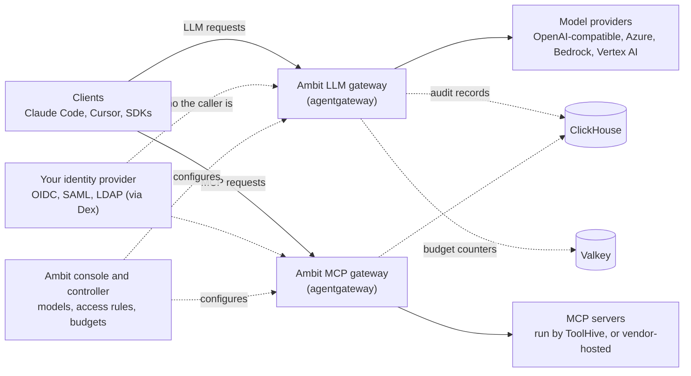

<p align="center">
  <picture>
    <source media="(prefers-color-scheme: dark)" srcset="docs/assets/brand/ambit-logo-dark.svg">
    
  </picture>
</p>

<p align="center"><b>Ambit is the AI access layer for enterprises.</b></p>

<p align="center">
  <a href="LICENSE"></a>
  <a href="https://github.com/craftsman-apps/ambit/actions/workflows/ci.yml"></a>
  <a href="https://github.com/craftsman-apps/ambit/releases"></a>
</p>

<p align="center">
  <a href="https://ambitproject.dev/docs/">Documentation</a> ·
  <a href="https://ambitproject.dev/docs/quick-start">Quick start</a> ·
  <a href="https://ambitproject.dev/docs/install">Install on your cluster</a> ·
  <a href="SECURITY.md">Security</a>
</p>

## What Ambit is

Ambit is a self-hosted gateway, built on agentgateway, ToolHive and other open-source projects, that controls a company's use of AI. It decides who may use which AI models and which work apps (through MCP), sets spending limits, keeps an audit record, and removes access when someone leaves the company.

[agentgateway](https://agentgateway.dev) handles the traffic and [ToolHive](https://github.com/stacklok/toolhive) runs the MCP servers. Ambit adds identity-provider access rules, a console, per-person app sign-in, budgets, audit and offboarding, in one Helm chart.

## Architecture



## Features

- **Approved models for coding tools.** Claude Code, Cursor and SDKs call your models through one address, with a personal API key or a token from your identity provider.
- **Models per team.** Access rules map identity-provider groups to models. Access is denied unless a rule allows it.
- **MCP servers with per-person sign-in.** People connect their own account to an app (for example GitHub or Slack). An admin chooses which tools of each MCP server a group may call.
- **Budgets.** Daily limits per group and per person, in requests and in estimated dollars.
- **Offboarding.** When the identity provider deactivates someone, Ambit revokes their sessions, API keys and stored app grants.

Every call is kept in an audit log, denied calls included, and shown in the console.

## Quick start

On a laptop with Docker, [kind](https://kind.sigs.k8s.io), kubectl and Helm. This installs release v0.1.0 for testing only (plain HTTP, one gateway replica).

```sh
R=https://github.com/craftsman-apps/ambit/releases/download/v0.1.0
curl -fsSLO $R/kind-cluster.yaml -O $R/quickstart.yaml -O $R/crds.yaml
kind create cluster --config kind-cluster.yaml
kubectl apply --server-side -f crds.yaml
helm install ambit-crds oci://ghcr.io/craftsman-apps/charts/ambit-crds --version 0.1.0 -n ambit-system --create-namespace --wait
helm install ambit oci://ghcr.io/craftsman-apps/charts/ambit --version 0.1.0 -n ambit-system -f quickstart.yaml --wait --timeout 10m
```

Open http://console.localtest.me:8080 and sign in as `admin@ambit.local`. `helm install` prints the command that shows the password.
The [full guide](https://ambitproject.dev/docs/quick-start) adds a free model, an access rule and a first call.

## Status: Alpha

Ambit is pre-1.0. The API is `ambitproject.dev/v1alpha1` and can change between releases.

| Tested | Not tested yet |
|---|---|
| Install and all features on kind, in CI on every pull request | Azure OpenAI, Amazon Bedrock and Vertex AI with real cloud accounts |
| Company sign-in through a test Keycloak, external ClickHouse and Valkey, GitOps with Argo CD | A 24-hour soak test (CI runs a 5-minute soak) |

## When not to use Ambit

- You need a hosted service. Ambit runs only in your Kubernetes cluster.
- You do not run Kubernetes. Ambit is installed with Helm and has no other install method.
- You need a stable API today. Wait for a release after `v1alpha1`.
- You need one proxy for a single team or one provider. A plain proxy is simpler.

## Documentation

- [Quick start](https://ambitproject.dev/docs/quick-start) and [Install on your cluster](https://ambitproject.dev/docs/install)
- [Concepts](https://ambitproject.dev/docs/concepts)
- [Models and providers](https://ambitproject.dev/docs/providers) · [Personal API keys](https://ambitproject.dev/docs/api-keys)
- [MCP servers and apps](https://ambitproject.dev/docs/presets) · [Budgets](https://ambitproject.dev/docs/budgets) · [Offboarding](https://ambitproject.dev/docs/offboarding)
- [Upgrading](https://ambitproject.dev/docs/upgrading)

## Credits

Ambit is built on these projects. Each keeps its own licence.

| Project | Use in Ambit | Licence |
|---|---|---|
| [agentgateway](https://github.com/agentgateway/agentgateway) | LLM and MCP traffic | Apache-2.0 |
| [ToolHive](https://github.com/stacklok/toolhive) | Runs MCP servers | Apache-2.0 |
| [Dex](https://github.com/dexidp/dex) | Sign-in and tokens | Apache-2.0 |
| [Gateway API](https://github.com/kubernetes-sigs/gateway-api) | Routing objects | Apache-2.0 |
| [ClickHouse](https://github.com/ClickHouse/ClickHouse) | Audit storage | Apache-2.0 |
| [OpenTelemetry Collector](https://github.com/open-telemetry/opentelemetry-collector-contrib) | Audit pipeline | Apache-2.0 |
| [Valkey](https://github.com/valkey-io/valkey) | Budget counters | BSD-3-Clause |
| [envoyproxy/ratelimit](https://github.com/envoyproxy/ratelimit) | Budget enforcement | Apache-2.0 |
| [MCP Go SDK](https://github.com/modelcontextprotocol/go-sdk) | Preset checks and test MCP servers | Apache-2.0 (older code MIT) |
| Kubernetes client libraries, controller-runtime, CEL-go | Controller and rules | Apache-2.0 |
| React, TanStack, Tailwind CSS, Radix UI | Console front end | MIT |
| IBM Plex (Fontsource) | Console fonts | SIL OFL 1.1 |

## Contributing, security, licence

- Contributing: [CONTRIBUTING.md](CONTRIBUTING.md). Conduct: [CODE_OF_CONDUCT.md](CODE_OF_CONDUCT.md).
- Security: report vulnerabilities privately, see [SECURITY.md](SECURITY.md).
- Licence: Apache-2.0, see [LICENSE](LICENSE) and [NOTICE](NOTICE).
