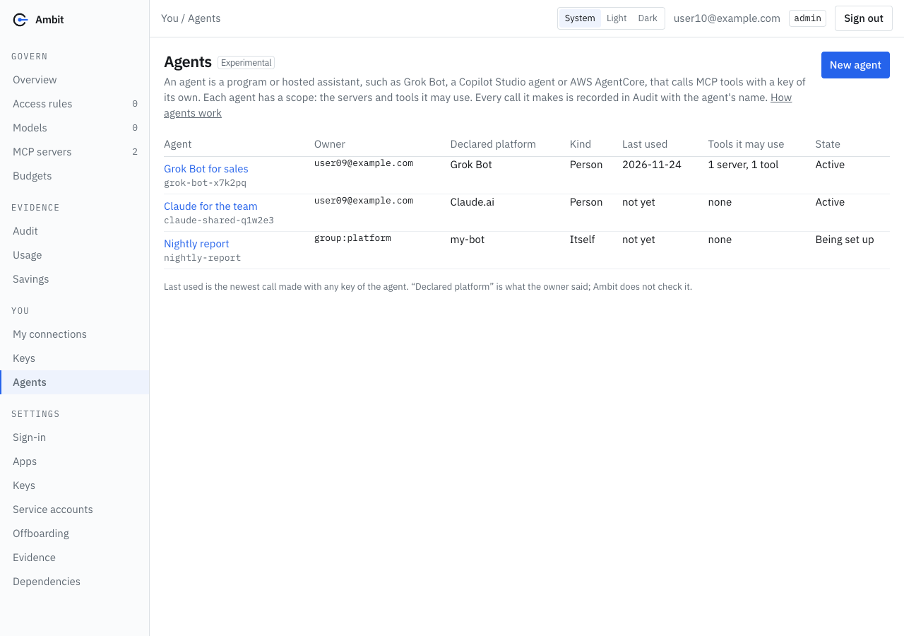
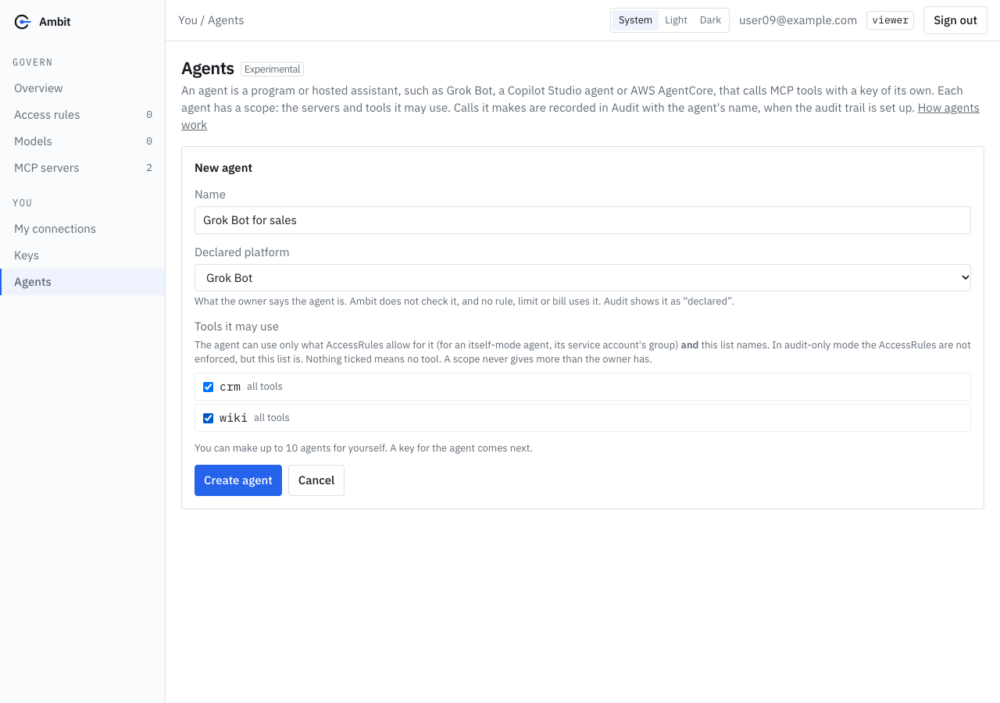
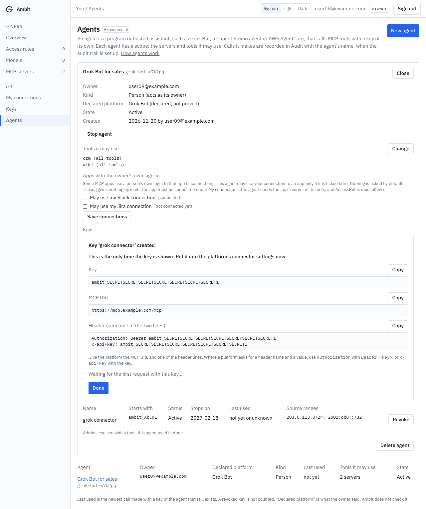
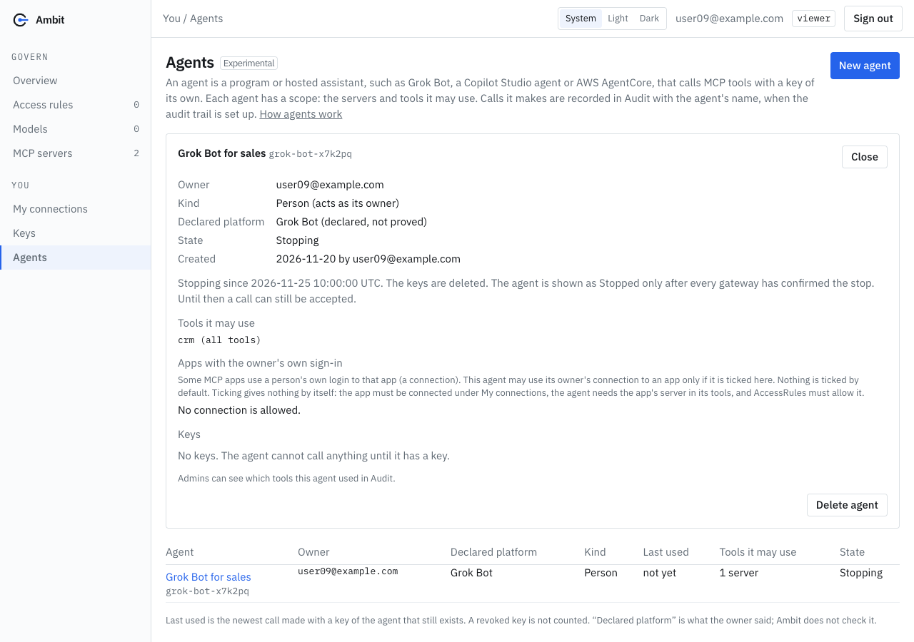
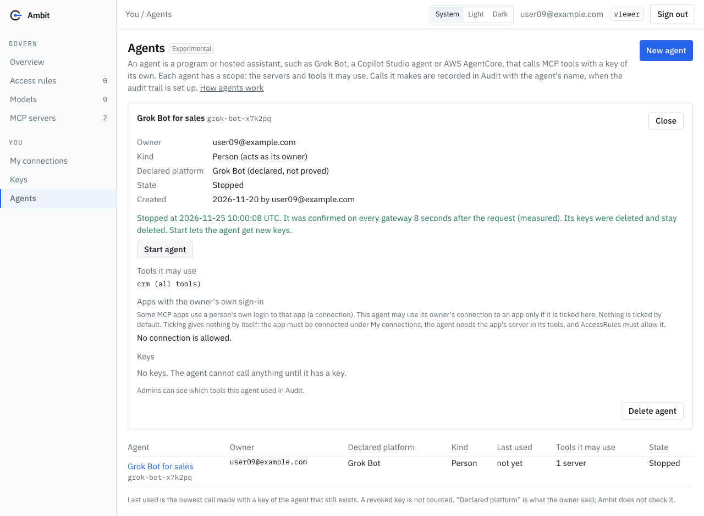
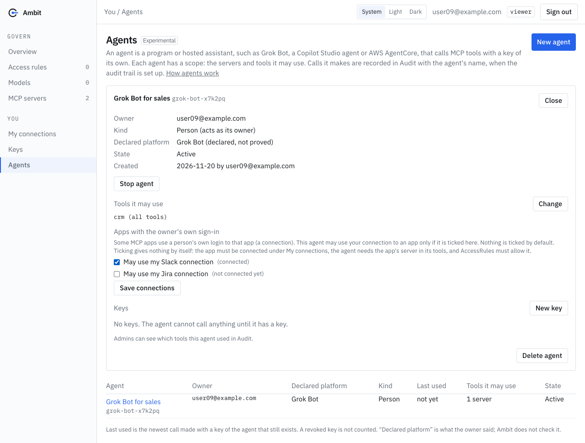
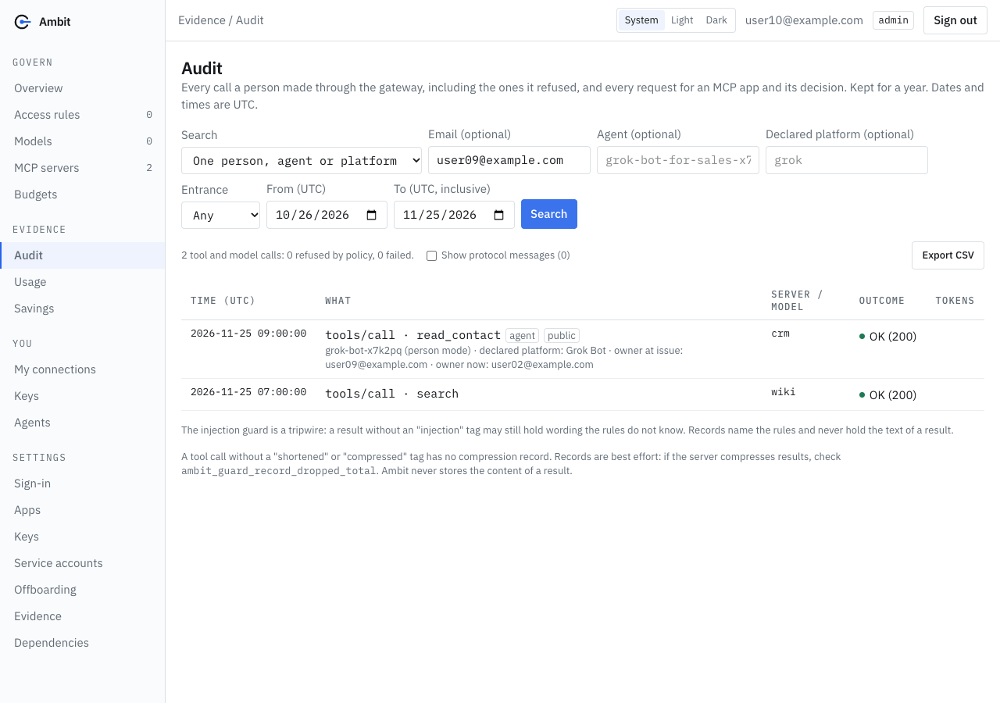

# Agents

> **Experimental in 0.6.x.** The agent API, the agent fields of a key, and the audit columns of an agent may change in
> 0.7.0, with a note in [Upgrading](upgrading.md). They do not change inside 0.6.x without a note. What other tools may
> rely on in 0.6.0 is listed in [What is stable](#what-is-stable).

An **agent** is a program or a hosted assistant that calls MCP tools with a key of its own: Grok Bot, a Copilot Studio
agent, an AWS AgentCore gateway, a Cloudflare worker, a script. A key that belongs to an agent has three more properties
than a [personal key](api-keys.md):

- It has a **scope**: a list of MCP servers and tools. The agent may use only what its owner's AccessRules allow **and**
  its scope lists. A new agent has an empty scope, which means no tool.
- Every call it makes is recorded with the **agent**, its **mode**, the **platform it declared** and its **owner at the
  time the key was issued**, so Audit can answer "which assistant did this, and for whom".
- It can be limited to **source address ranges**, so a key stolen from a platform's configuration does not work from
  another network.

Agents add no budget and no limit of their own. [Budgets](budgets.md) count model requests only, and MCP calls are not
counted by any limiter in 0.6.0. See [Limits that apply](#limits-that-apply).

## Two kinds of agent

| | Person mode | Itself mode |
|---|---|---|
| Who creates it | Any signed-in person, **for themselves** | Admins only |
| Who it acts as | Its owner: the same email, groups, AccessRules, budgets and offboarding as the owner's own keys | A [service account](service-accounts.md) `<name>@svc.ambit.internal` with one group |
| Owner | The person who created it. It never changes. | A person or a group (`group:platform`) that is accountable for it. An admin can move it. |
| Keys | Up to 2 live keys, end date up to `agents.keyMaxDays` (default 90 days). They stop when the owner has not signed in for `apiKeys.inactivityDays`, as personal keys do. | Up to 2 keys (the account's limit), end date up to `agents.keyMaxDays`. They do not stop for inactivity. |
| App connections | Only the apps the owner ticked for this agent (see [Apps with a person's own sign-in](#apps-with-a-persons-own-sign-in)) | None in 0.6.0 |

There is **no delegation**: an agent never acts for a person other than its owner. A team that wants one shared
assistant uses one itself-mode agent, which Audit shows as that service account, never as a person. If every person
should act as themselves, each makes their own person-mode agent.

## The Agents page

**You → Agents** in the console lists the agents you may see: your own, and for admins every agent. Each row shows the
owner, the **declared platform**, the kind (person or itself), the last use, the tools the agent may use (its scope) and
its state.



- **Declared platform** is what the owner said the agent is. Ambit does not check it, and no rule, limit or bill uses it.
  The console and Audit always call it "declared".
- **Last used** is the newest call made with a key of the agent that still exists (a revoked key is not counted). If the console has no audit trail (ClickHouse is not set
  up), it says "unknown", and says why.
- **Tools used** (the calls of the last 30 days, counted per tool) are on the agent's detail page, for admins, because
  they come from the audit trail, which only admins may read. A person sees a note that admins can look it up in Audit.
- **No agents yet** shows a short explanation and the **New agent** button. When your administrator has switched agents
  off, the page says so and has no button.

**New agent** asks for a name, a declared platform and the tools the agent may use. Nothing ticked means no tool. A
person makes agents for themselves only. Admins also see the choice **Itself**, which makes a service account with an
owner (a person or `group:name`), a group and an account name.



The detail page shows the agent's facts, its scope (with **Change**), and its keys. **New key** asks for a key name, an end
date and, if you want, source address ranges. The key is shown **once**, together with the MCP URL and the two header forms
(`Authorization: Bearer` and `x-api-key`). The page never shows it again: it keeps only the start of the key.



**Revoke** deletes one key. **Delete agent** deletes the agent, its keys and (itself mode) its service account.

### Stop and start

**Stop agent** is on the detail page, for the owner (person mode) and for admins. The page asks first, and says what a stop
is: the keys are deleted at once, and the page shows **Stopped** only after every gateway has confirmed the stop. While it
waits, the agent is **Stopping**, the page asks again every 2 seconds, and it says that a call that is already on its way can
still be accepted. It never says that no call is accepted: the console measures the calls that were accepted after the request
(see [Stopping an agent](#stopping-an-agent)).



When the stop is confirmed, the page shows the time and how many seconds after the request it was confirmed, as the console
measured it. If a gateway has not confirmed after 60 seconds, the page says so, and says that the steps are repeated until it
does. If the stop list is full, it says that too. Admins get a link to the **stop evidence** (`agent-stop.zip`): the time of
each step, each gateway's confirmation and the calls accepted after the request, counted.



**Start agent** lets a stopped agent get new keys. The old keys stay deleted. The console refuses a start for one minute after
the keys were deleted, and the page shows its reason.

### Apps with the owner's own sign-in

For a person-mode agent, the owner sees one box for each of their connections: **May use my Slack connection**. Nothing is
ticked by default. Save writes `connectionConsent`. A box gives nothing alone: the app must be connected under **My
connections**, the agent needs the app's server in its tools, and AccessRules must allow it. Only the owner changes the boxes;
an admin sees the list. An itself-mode agent gets no app connections in 0.6.0.



### When the owner leaves

An agent whose owner left shows a banner with the date. It keeps working for the time set in `agents.orphanDays` (7 days by
default), then it is stopped. An admin moves an itself-mode agent to a new owner in the banner.

## Create an agent and a key in the API

The same, with the API:

```sh
# as a signed-in person: an agent for yourself (the name is made from the display name)
curl -s -b "$COOKIES" -X POST "$CONSOLE/api/agents" -H 'Content-Type: application/json' \
  -d '{"displayName":"Grok Bot for sales","platform":"grok","scope":["crm/read_contact","wiki"]}'
# a key for it: shown once
curl -s -b "$COOKIES" -X POST "$CONSOLE/api/agents/grok-bot-for-sales-x7k2pq/keys" -H 'Content-Type: application/json' \
  -d '{"name":"grok connector","days":30,"sourceRanges":["203.0.113.0/24"]}'
```

An admin creates an itself-mode agent with a service account of its own:

```sh
curl -s -b "$COOKIES" -X POST "$CONSOLE/api/agents" -H 'Content-Type: application/json' \
  -d '{"mode":"itself","name":"nightly-report","displayName":"Nightly report","group":"ops","owner":"group:platform","platform":"agentcore","scope":["reports"]}'
curl -s -b "$COOKIES" -X POST "$CONSOLE/api/agents/nightly-report/keys" -H 'Content-Type: application/json' \
  -d '{"name":"report job","days":90}'
```

Give the key to the platform as an MCP header: `Authorization: Bearer ambit_...` or `x-api-key: ambit_...`. The URL is the
MCP URL of your install (`mcp.host`).

- **Scope.** A list of up to 50 entries. `crm` allows every tool of the server `crm`; `crm/read_contact` allows one tool.
  A scope narrows the owner's rights; it never adds to them. Empty means no tool.
- **Platform.** What the agent says it is: `chatgpt`, `claude-ai`, `gemini-enterprise`, `copilot-studio`, `grok`,
  `agentcore`, `cloudflare`, `orca`, `other`, or any other lower-case word (up to 40 characters). It is **declared, never
  proved**. No policy, limit or bill uses it.
- **Source ranges.** Up to 10 CIDR ranges per key (`203.0.113.0/24`, `2001:db8::/32`). A key with ranges is accepted only
  from an address inside one of them. Which address the gateway sees depends on how traffic reaches it (a load balancer
  that hides the client address makes every request look like one address; set the ranges only when you know the
  address the gateway sees).
- **Changing the scope or the platform** rewrites the metadata of the agent's keys, and the gateway uses the new scope
  as soon as it has read the changed key (about a second on kind; see [Measured](#measured)). If some key could not be
  updated, the request fails with 503 and the saved change is finished by sending the same request again, or by the hourly
  repair.
- **Narrowing a scope** is enforced first: the keys are narrowed, and only then is the new scope saved. If a key cannot be
  narrowed, nothing is saved (503) and the old scope stays; send the request again.
- **Deleting an agent** first records state `deleting` (no new keys), then deletes its keys, its service account (itself
  mode; the name stays taken) and its record. If a step fails, the same request, or the hourly repair, finishes it.
- A person-mode agent's keys are the person's keys too: they count among the person's 20 keys, appear in **Keys**, are
  revoked by `DELETE /api/keys/{id}` and are deleted when the person is [offboarded](offboarding.md).

## What the gateway checks

For an agent's key the gateway checks, in this order, and answers **403** when one fails:

1. The key is valid and has not ended (as for every key: [How the gateway checks a key](api-keys.md#how-the-gateway-checks-a-key)).
2. If the key has source ranges, the client address is inside one of them.
3. The owner is not on the offboarding block list.
4. For each MCP call: the owner's AccessRules allow the tool **and** the key's scope lists its server or the tool.

The scope is in the key's metadata (`apiKey.agentScope`), not in the access policy, so the policy has the same length
with 0 agents and with 2,000 agents. A key of an agent that has no scope list at all, or whose scope is not a list, may
use no tool.

**Audit-only mode** (`access.mode: audit`) relaxes the owner's AccessRules only. An agent's scope is part of its key, not
an AccessRule, so it stays enforced in audit-only mode.

**No key before the gateway enforces the scope.** The controller publishes in `ambit-access-mode` (`agentScope: "1"`) that
the MCP policy in force has the scope clause, after agentgateway applied it. Until then the console refuses to create an
agent key (503, "agents are not ready"). So a console that is upgraded before the controller, or a policy that
agentgateway rejected (for example because it grew over the 16,384-character limit), never gives out a key that the
gateway would not limit.

## Stopping an agent

Stop an agent when it misbehaves, when its platform is compromised, or when its owner leaves. **A stop is a state machine, not
a switch**: Ambit reports an agent as stopped only after every Gateway has confirmed the stop. It never promises that no call
is accepted after the request; it measures how many were.

```sh
curl -s -b "$COOKIES" -X POST "$CONSOLE/api/agents/grok-bot-for-sales-x7k2pq/stop" -H 'Content-Type: application/json' -d '{}'   # 202
curl -s -b "$COOKIES" "$CONSOLE/api/agents/grok-bot-for-sales-x7k2pq"                                                       # "state": "stopped" when confirmed
curl -s -b "$COOKIES" -X POST "$CONSOLE/api/agents/grok-bot-for-sales-x7k2pq/start" -H 'Content-Type: application/json' -d '{}' # a stopped agent gets new keys again
```

The owner (person mode) or an admin stops an agent; admins also stop itself-mode agents. Stopping works when `agents.enabled` is
`false`.

```
 active --Stop--> stopping --S2, S3 done, every Gateway confirmed--> stopped --Start--> active
                  |  ^
                  |  +-- the steps are repeated every 2 s until they work
                  +-- after 60 s without confirmation: event, alert "stop not confirmed on <Gateway>"
```

| Step | Who | What |
|---|---|---|
| S1 | console | Writes the agent to the stop list (ConfigMap `ambit-agent-stops`, a new list generation) and records state `stopping` |
| S2 | console | Deletes every key of the agent (also a key made while it is stopping) |
| S3 | console | Revokes the agent's OAuth grants (none before OAuth) |
| S4 | controller | Renders the list into Require policies `ambit-agent-stops-<k>` on **every MCP and LLM route of every Gateway** (at most 150 agents per policy) |
| S5 | controller | Reads each policy's status per route: a Gateway **acknowledges** the list generation when all its routes accepted every policy at its current generation (plus the settle time, `--activation-settle`). The answer is in ConfigMap `ambit-agent-stops-ack` |
| S6 | console | State `stopped` when S2 and S3 are done and every Gateway acknowledged the entry's generation. Writes the History event |

The **stop policy is the authoritative check for every credential the gateway accepts**: a key of a listed agent is refused
(403) by the gateway even while its Secret still exists, and so is a token that names the agent or its grant. Deleting the keys
(S2) is the second line.

**Where the acknowledgment comes from.** Each policy is attached to routes, and agentgateway reports per route whether it accepted
and attached the policy at its current generation. A Gateway is **ready** only while every policy of the list's current generation
is accepted on its routes, has not been rejected by a proxy since it was written (the Gateway's NACK events) and has
settled (`--activation-settle`, 3 s: agentgateway v1.7.0 has no acknowledgment from the proxies that a controller can read).
If a stop policy is edited, deleted or rejected afterwards, the Gateway is no longer ready, and the console neither completes nor
prunes a stop until it is. The answer is bound to the stop list it was made for (its UID) and only the controller may write it
(admission policy `ambit-agent-ack-writer`). A route that is attached to more than one Gateway counts for each of them.

The controller renews its answer every 30 s while the list has entries; the console treats an answer older than two minutes as no
answer, so a controller that is down cannot leave an old "ready" in force (the agent stays `stopping`). Both stop ConfigMaps
(`ambit-agent-stops`, `ambit-agent-stops-ack`) are fenced by name: only the console writes the list and only the controller the answer, labelled or
not. The names `stops` and `stops-ack` are reserved and cannot be the name of an itself-mode agent (their records would be these ConfigMaps).

**The list is stable.** An entry has a fixed slot (0 to 999) and is in policy slot ÷ 150; adding or removing an entry never moves
another one to another policy, so a change of one policy never takes a still-listed agent out of the block.

**Start.** `start` removes the entry. It is refused (409) for one minute after the keys were deleted, so that the proxies have dropped
them; with OAuth it waits for the whole retention, because an access token already issued stays valid until it expires.

**Retention.** An entry stays in the list until the agent's credentials are gone, every Gateway acknowledged it, and
`agents.stopRetentionMinutes` (25: the access token life of 15 minutes and 10 minutes of leeway) have passed. Then it is
pruned; the agent record keeps `state: stopped`. Start removes the entry at once.

**Fail closed.**
- The controller never deletes a stop policy while an entry exists. If the list cannot be rendered (more than 1,000 entries, an unreadable list), it keeps the policies in force, writes `degraded` into the acknowledgment and sets the alert `AmbitStopPolicyDegraded`.
- A partial rollout (one Gateway confirmed, another not) stays `stopping`, and the alert and the event name the Gateway that is late.
- If the list is **full** (1,000 entries), the stop still runs S2 and S3, the agent is marked `stopUnlisted`, and it stays `stopping` until there is room (the console tries every 2 s). Keys are gone; tokens (with OAuth) expire within 15 minutes.

**The limits, stated honestly.** What a stop can and cannot do depends on what is working:

| Failure | Keys | Measured |
|---|---|---|
| none | refused after the proxies learn of the policy and the key deletion | refused **0.92 s** after the request (p50; p95 0.94 s, p99 0.94 s, max 0.94 s in 20 runs); a client calling every 25 ms had 36 calls accepted after the request (max 37); reported `stopped` after 8.3 s |
| Ambit controller down | refused after S2 as usual; the stop is not confirmed (state stays `stopping`) until it is back | key refused after 0.73 s (29 accepted calls in between); the agent stayed `stopping` and was reported "not confirmed" after 60 s; confirmed after the controller was back |
| agentgateway controller down | **not refused until it is back**: the proxies keep their last configuration | in the first 20 s **874 calls with the deleted key were accepted** (none refused); the first refusal came 30.7 s after the request, when the control plane was back |
| console down | a stop cannot be requested. Emergency stops: the Helm values `apiKeys.enabled: false` (all keys) and `agents.enabled: false` | not applicable |

Measured on kind with agentgateway v1.7.0, one gateway pod, a polling client with the key (`test/stepagents.sh`, 2026-11-25). Real clusters
with more proxy pods, a network and a load balancer will differ; run the test on yours before you rely on a number. A controller restart during
a stop delayed the confirmation to 26.4 s. A partial rollout across two Gateways is covered by the controller's tests (one Gateway ready, the other not: the agent stays `stopping`).

An OAuth access token is checked offline by the gateway; once OAuth exists, a token stays valid until it expires (at most 15 minutes) when
no stop policy applies.

**Evidence.** `GET /api/evidence/agent-stop/<agent>.zip` (admins, needs `evidence.enabled`) holds `timeline.csv` (request, keys deleted,
grants revoked, each Gateway's acknowledgment, stopped, with seconds from the request), `calls-after-request.csv` (every call that
carries the agent's name from the request on, with its status) and `summary.csv`: **the measured number of accepted calls after the
request, and the time to the first refused call**, per Gateway. There is no "expected 0" column. A call with a key that was already
deleted is logged as an invalid key without the agent's name, so it is not in the file; a refusal by the stop policy is.

**When the owner leaves.** [Offboarding](offboarding.md) stops all of the person's person-mode agents with this state machine.
Their itself-mode agents are marked **orphaned**: they keep working for `agents.orphanDays` (7), with `orphanedAt` in the
record, so that an admin can move them (`PUT /api/agents/{name}/owner`); then they are stopped.

## Audit

Every record of a call made with an agent's key has these attributes in `otel_logs` (`LogAttributes`), taken only from
the verified key:

| Attribute | Meaning |
|---|---|
| `ambit.agent` | The agent's name (empty for a call that is not an agent's) |
| `ambit.agent_mode` | `person` or `itself` |
| `ambit.agent_owner_at_issue` | The owner when the key was issued. It never changes. |
| `ambit.platform_declared` | The platform the agent declared. Never a proof. |
| `ambit.grant_id` | The OAuth grant (empty until OAuth is available) |
| `ambit.token_issuer` | The validated issuer of a token (empty for keys) |
| `ambit.ingress` | `private` or `public`: the Gateway that took the call. Written only with the [public front door](front-door.md) (`frontDoor.enabled`); empty without it |

Records written before this release do not have them, and keep exporting with empty cells.

The **Audit** page (**Evidence → Audit**, admins) has the fields **Agent**, **Declared platform** and **Entrance** (private
or public) next to **Email**. An agent or a declared platform alone selects calls the way an email does, and then the email
is optional; the entrance only narrows one of them, so it is off until one of them is filled in. A call made with an agent's
key has an **agent** badge. Under it the row says which agent (and its mode), the declared platform, the owner when the key
was issued and, if the agent was moved since, the owner now. A call that came in through the public entrance has a
**public** badge. **Export CSV** has the same eight columns as `calls.csv`, after the columns it had before. **Search Audit for
this agent** on the agent's page opens the search for it.



The Audit API accepts `agent=`, `platform_declared=` and `ingress=` (`private` or `public`) next to `email=`. An agent or a
platform alone selects calls the way an email does; `ingress` only narrows another filter.

```sh
curl -s -b "$COOKIES" "$CONSOLE/api/audit?agent=grok-bot-for-sales-x7k2pq&from=2026-12-01&to=2026-12-08"
```

Each call in the answer has `agent`, `agentMode`, `agentOwnerAtIssue`, `agentOwnerNow` (the agent's record when you
read, so a moved agent shows both), `platformDeclared`, `grantId`, `tokenIssuer` and `ingress`. The evidence export
`calls.csv` appends the columns `agent, agent_mode, agent_owner_at_issue, agent_owner_now, platform_declared, grant_id,
token_issuer, ingress` after `call_id`. The columns before them keep their place.

## Apps with a person's own sign-in

A [Connection](presets.md) lets a person use an MCP app with their own login to that app. A person-mode agent may use the
person's connection **only for the apps the person ticked for that agent**. The list is the agent's `connectionConsent`
(names of Connections; empty by default), set with `PATCH /api/agents/{name}`:

```sh
curl -s -b "$COOKIES" -X PATCH "$CONSOLE/api/agents/grok-bot-for-sales-x7k2pq" -H 'Content-Type: application/json' \
  -d '{"connectionConsent":["slack"]}'
```

How it is checked, on every request that needs a connection token:

1. The gateway names the calling agent to the token broker in the header `x-ambit-agent`. The gateway computes it from the
   **verified key** (or token), never from a header of the client: a client's own `x-ambit-agent` has no effect. A person's
   own key or token gets the value `-`.
2. The broker reads the agent's record each time (no cache). It gives the owner's token only when the record is readable and
   signed by the console, the agent is active and in person mode, the agent's owner is the person the gateway named, and the
   connection is in `connectionConsent`.
3. In every other case (no header, an unknown or unreadable record, a stopped agent, an itself-mode agent, no consent) the
   broker gives **no token**. The app then decides what to do with a request that has no token: it normally refuses, and the
   gateway leaves that server out of the agent's session. If every server of a session refuses, the session itself can fail
   to open (agentgateway v1.7.0 opens a session only when at least one server answers).

Consent alone gives nothing: the person must have connected the app themselves (**My connections**), and the agent still
needs the server in its scope and in the owner's AccessRules. An itself-mode agent gets no app connections in 0.6.0. The
gateway's policy that sends the header is generated by the Ambit controller; until the controller of this version has written it,
no connection token is given to anyone (the broker refuses a request without the header).

## Limits that apply

| Limit | Applies to | Counted by |
|---|---|---|
| Model budgets (requests per day, dollars per day, requests per minute) | The model calls of a person-mode agent count as its owner; an itself-mode agent counts as its service account, one person of its group | The ratelimit service, as today |
| `agents.maxTotal` (2,000 agents), `agents.maxPerPerson` (at most 10 person-mode agents) | Creating agents | The console |
| Keys per agent: 2; source ranges per key: 10; scope entries per agent: 50 (each at most 200 characters); connections per agent: 20 | Creating keys, changing agents | The console |

**No limit counts MCP calls in 0.6.0**, for agents or for people ([Budgets](budgets.md#per-minute-limits)). Agents have no
spending limit and no call limit of their own.

## Where it is stored

| Object | Where | Bound |
|---|---|---|
| Agent record | One ConfigMap `ambit-agent-<name>` (label `ambitproject.dev/agent`), no secrets. Only the console may write it (admission policy `ambit-keys-writer`). | 16 KiB each (50 scope entries of the longest allowed length need about 11 KiB); 2,000 in all |
| Agent key | A key Secret, as every key, with the label `ambitproject.dev/agent=<name>` | As keys |
| Key metadata | `agent`, `agentMode`, `agentOwnerAtIssue`, `platformDeclared`, `agentScope`, `agentRev`, `sourceRanges` | Under 16 KiB with the largest scope |

Each record carries a signature that only the console can make (HMAC with a key derived from the console's session key).
A record without a valid signature, planted or changed by anything else, is not an agent: it is ignored, and the hourly
repair deletes it.

The console fails closed. When the agent records cannot be read, no key is created. The hourly repair deletes the keys of
an agent whose record is missing, unreadable or not active, finishes a delete that stopped half way (state `deleting`),
and deletes an itself-mode record that never got bound to its service account (state `pending` for more than 10
minutes). An itself-mode record is bound to its service account's owner record (by UID): it never acts on another
account of the same name.

When the limit is reached the create request answers **409** `agent limit reached` and nothing else changes.

## What is stable

Everything on this page is experimental in 0.6.x. A later release may change it, with a note in
[Upgrading](upgrading.md). What other tools may rely on in 0.6.0 is the `ambit_` key format (unchanged), the seven audit
attributes above, and the columns appended to `calls.csv`.

## Public API (experimental)

| Endpoint | Who |
|---|---|
| `GET /api/agents` (add `?all=true` for every agent) | The caller's agents; admins for all |
| `POST /api/agents` | Any signed-in person (person mode); admins (itself mode) |
| `POST /api/agents/{name}/stop`, `POST /api/agents/{name}/start`, `GET /api/evidence/agent-stop/{agent}.zip` | The owner (person mode) or an admin; admins for itself mode and the export |
| `GET /api/agents/{name}`, `PATCH /api/agents/{name}`, `DELETE /api/agents/{name}` | The owner (person mode), admins (itself mode; and delete for any agent) |
| `POST /api/agents/{name}/keys` | The owner (person mode), admins (itself mode) |
| `PUT /api/agents/{name}/owner` | Admins, itself-mode agents |
| `GET /api/audit?agent=&platform_declared=&ingress=` | Admins |

Answers to people who may not see an agent are `404`, not `403`, so a name is not confirmed.

The Agents page and the Audit filters use only the endpoints on this page and the key endpoints of [Personal API keys](api-keys.md) (`GET /api/keys`, `GET /api/admin/keys`, `DELETE /api/keys/{id}`, `DELETE /api/admin/keys/{id}`). They have no private API.

## Measured

The scope and source-range checks run in the gateway's own policy engine, with no call to another service. The numbers of
the end-to-end test (`test/stepagents.sh`) and of the 2,000-agent test are in the pull request that added them.

See also: [Personal API keys](api-keys.md), [Service accounts](service-accounts.md), [Offboarding](offboarding.md),
[Compliance and audits](compliance.md).
