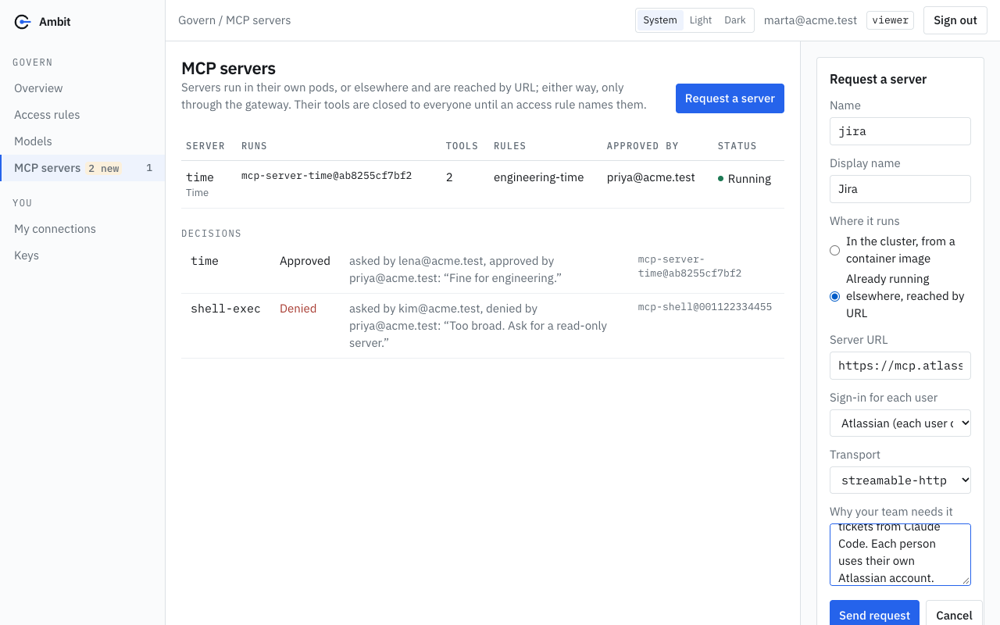

# Ask for an MCP app and approve it

**What you get:** any signed-in person can ask for a new MCP server (an "app"). Nothing runs and no tool is available until an approver, a different person, approves the request. The request stays as the record of who asked, who decided, and which image digest or address was approved.

**The steps, in short.** A person sends a request in the console. An approver approves or denies it. Approval creates the `Server`. An admin then writes an access rule that gives a group the tools. Until that rule exists, nobody can call the server.

## Who can do what

| Person | Ask for a server | Approve or deny | Write the access rule |
|---|---|---|---|
| Anyone signed in to the console (role `viewer`) | Yes | No | No |
| Member of the group `ambit-approvers` (role `approver`) | Yes | Yes, but not their own request | No |
| Member of the group `ambit-admins`, or the bootstrap `admin@ambit.local` (role `admin`) | Yes | Yes, but not their own request | Yes |

The roles come from groups that your identity provider sends. See "Console roles" in [Install on your cluster](../install.md). Nobody can decide on their own request. This includes admins. If an admin asks for a server, another approver or admin must decide.

## 1. Ask for a server

Open **MCP servers** in the console and choose **Request a server**. Fill in the form:



| Field | What to enter |
|---|---|
| **Name** | The name the server gets: lowercase letters, digits and dashes, at most 40 characters. Clients see its tools as `<name>_<tool>`. |
| **Display name** | A readable name for the console. Optional. |
| **Where it runs** | **In the cluster, from a container image:** Ambit starts the image. Or **Already running elsewhere, reached by URL:** Ambit only connects to it. |
| **Image, pinned by digest** | For an image. It must look like `ghcr.io/org/server@sha256:<64 hex characters>`. A tag is refused, because a tag can later point to different code. |
| **Server URL** | For a server reached by URL. It must look like `https://host/path`, without a query string or fragment. Plain `http` is accepted only for services inside the cluster (`*.svc`) and for `localhost`. |
| **Sign-in for each user** | Only for a server reached by URL. Choose the app connection when each person must sign in to the vendor with their own account. Admins add connections under **Settings**, **Apps** (see [App presets](../presets.md)). |
| **Transport** | `stdio` for an image. `streamable-http` or `sse` for a URL. |
| **Why your team needs it** | Free text, at most 2000 characters. The approver reads it. |

Choose **Send request**. The console records your email address from your sign-in as the requester. You cannot type another name.

The console refuses a request when:

- the name is already used by a server, or by another request that still waits for a decision;
- both an image and a URL are given, or neither;
- the image is not pinned by a digest, or the URL is not valid;
- the connection you chose does not exist.

A request cannot be changed after it is sent. If something is wrong, ask for the server again with the corrected values. An approver can deny the first request.

## 2. Approve or deny

An approver sees the request under **Waiting for an approver** on the **MCP servers** page. The card shows the name, who asked, the image digest or URL, the transport and the reason.


Check these before you decide:

- **Image:** the digest is exactly the code that will run. Approving starts exactly this digest.
- **URL:** approving lets the gateway reach this address.
- **Reason:** does the team need it?

Write a comment if you want the requester to know why. The comment is optional, at most 2000 characters, and is kept with the decision. Then choose **Approve** or **Deny**.

**Approve** creates the `Server` with the name and settings from the request. The server starts (image) or is checked (URL). Its tools are closed to everyone. The card says so: "Access still needs a rule."

**Deny** creates nothing. The request stays in the **Decisions** list with your comment.

A decision cannot be changed. If two approvers decide at the same moment, the second one gets the message "someone else decided on this request first".

If the name of the server was taken by someone else after the request was sent, approval fails with "a server named ... already exists; deny this request".

### GitOps mode

When the console runs in GitOps mode, approval does not change the cluster. It opens a pull request in your configuration repository with the `Server`. The request is marked **Approved** at once and shows a link to the pull request. The `Server` appears when someone merges the pull request and Argo CD applies it. The merge is a second review. If the pull request is closed without a merge, the request still says Approved, but no server exists. See [Install on your cluster](../install.md), section "Argo CD and GitOps".

## 3. Give a group the tools

Approval does not give anyone access. An admin writes an access rule that names the server, the groups and, if wanted, single tools. Follow step 1 of [Give an agent tools and apps](mcp-apps.md). For a server with a sign-in for each user, an admin must also choose **Use my account to read tools** on the **MCP servers** page, so that the tools are known. See [App presets](../presets.md).

## What is recorded

| Where | What it holds |
|---|---|
| The `ServerRequest` object in the namespace `ambit-system` | Spec: the server name, the full server settings (the image digest or URL, the transport, the connection), the reason, and `requestedBy`. The creation time is the time of the request. Status: `decision` (`Approved` or `Denied`), `decidedBy`, `decidedAt`, `comment`, and `pullRequest` in GitOps mode. Kubernetes refuses a change of the spec and a change of a decision. The object is kept after the decision. |
| The `Server` object | The annotations `ambitproject.dev/requested-by`, `ambitproject.dev/approved-by` and `ambitproject.dev/server-request` (the name of the request). The console shows them as **Approved by** and "asked for by". |
| The console | The **Decisions** list under the servers: who asked, who decided, the comment, and the pull request link. |
| The log of the console pod | One line for each request, approval and denial, with the request, the server, the image or URL, and the emails. |

Read the records with `kubectl`:

```sh
kubectl -n ambit-system get serverrequests.ambitproject.dev
```

```text
NAME              SERVER   REQUESTED BY      DECISION   DECIDED BY
jira-x7k2p        jira     marta@acme.test   Approved   priya@acme.test
```

The **Audit** page does not list requests and decisions. It lists the calls that pass the gateway. After approval, calls to the new server's tools appear there, and calls that no rule allows are refused and listed too. To answer "who approved this server and which image?", use the `ServerRequest`, the `Server` annotations or the **Decisions** list.

## Related

- [Give an agent tools and apps](mcp-apps.md): access rules for the tools of a server.
- [App presets](../presets.md): servers that need a personal sign-in at the vendor.
- [Install on your cluster](../install.md): console roles, single sign-on and GitOps.
- [Compliance and audits](../compliance.md): how the roles and the separation of duties map to controls.
