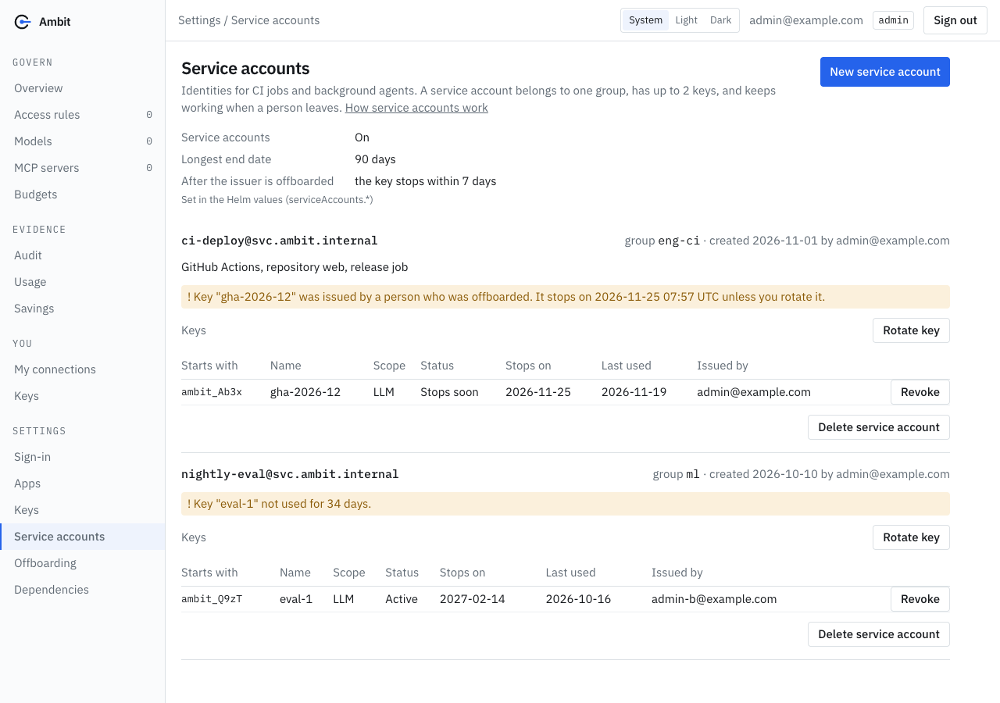

# Service accounts

A service account is an identity for a program, not for a person: a CI job, a nightly evaluation, a background
agent. It calls models and MCP tools **as itself**. Audit shows it, its group's budgets apply to it, and it keeps
working when a person leaves the company.

Without a service account, a CI job borrows a person's [personal API key](api-keys.md). Then Audit names the wrong
person, the job spends that person's budget, and the job stops when the person leaves or does not sign in to the
console for 30 days.

## What a service account is

- An identity of the form **`<name>@svc.ambit.internal`**, for example `ci-deploy@svc.ambit.internal`. The domain is
  reserved: the gateways refuse a token with such an email, the console refuses such a sign-in, and SCIM refuses
  such a user. Only a service account's key can carry it.
- **One group**, chosen when the account is created, for example `eng-ci`. The account gets what AccessRules and
  Budgets give that group or its identity. The group cannot change; to change it, create a new account.
- **Up to 2 keys**. They are ordinary Ambit keys (`ambit_...`), with an end date of at most `serviceAccounts.maxDays`
  (default 90 days). They do not stop for inactivity: nobody signs in for a service account.
- Only **admins** (members of `ambit-admins`) create accounts, create keys and delete accounts. An admin sees the key
  once, when it is created.
- **Names are never reused.** A deleted account keeps its name, so an AccessRule or an Audit search for
  `ci-deploy@svc.ambit.internal` can never start to mean another account.

A service account is not a Kubernetes ServiceAccount and has nothing to do with one.

## Agents that are service accounts

An [itself-mode agent](agents.md#two-kinds-of-agent) is a service account with an accountable owner (a person or a group),
a declared platform and a scope. Admins create it with `POST /api/agents` (`"mode":"itself"`); the page here keeps listing
the account. Create its keys on the agent (`POST /api/agents/{name}/keys`), not here: a key made on this page would not
carry the agent's scope, so the page refuses to create keys for an account that is an agent (400). Deleting the account on
this page deletes the agent's record too. The exposure rule below applies to an agent's keys like any other key issued by
an admin.

## Create an account and a key



1. In the console, open **Settings → Service accounts** and choose **New service account**.
2. Enter a name (lowercase letters, digits and `-`, 1 to 40 characters). The page shows the identity as you type.
3. Enter the group. A group of its own, such as `eng-ci`, is best (see [Budgets](#budgets)). The console role groups
   `ambit-admins` and `ambit-approvers` are not allowed.
4. Enter a description that says which job uses it, for example "GitHub Actions, repository web, release job".
5. Choose **New key**: a key name, the scope (LLM, MCP or both) and the end date. The key is shown once, with the
   setup steps. Put it in the CI system's secret store now.
6. Write an AccessRule that gives the group or the identity the models and tools the job needs (next section).

The same through the API (an admin's console session):

| Method and path | Body | Answer |
|---|---|---|
| `GET /api/admin/service-accounts` | | `{settings, accounts: [{name, identity, group, description, created, createdBy, keys, warnings}]}` |
| `POST /api/admin/service-accounts` | `{name, group, description}` | `201 {account}` |
| `POST /api/admin/service-accounts/{name}/keys` | `{name, scope, days}` | `201 {key, view, urls}`; the key is in this answer only |
| `DELETE /api/admin/keys/{id}` | | `204`: revoke one key (the same endpoint as for personal keys) |
| `DELETE /api/admin/service-accounts/{name}` | | `204`: delete every key, then the account |
| `DELETE /api/keys/self` | the key as `Authorization: Bearer` | `204`: the key revokes itself, for example in a cleanup step |

Refusals: 400 bad input, 403 not an admin, 404 no such account, 409 service accounts switched off or the name was
used before, 429 too many accounts (200) or keys (2 per account, 10 creations per admin per hour), 503 with
`Retry-After` while a console restarts.

## Use the key in CI

The key works like a personal key: in `Authorization: Bearer <key>` or in `x-api-key`.

GitHub Actions: add the key as a repository secret named `AMBIT_API_KEY`
(Settings → Secrets and variables → Actions), then in the workflow:

```yaml
jobs:
  release-notes:
    runs-on: ubuntu-latest
    environment: release   # optional: an environment with required reviewers protects the secret
    env:
      OPENAI_BASE_URL: https://llm.example.com/v1
      OPENAI_API_KEY: ${{ secrets.AMBIT_API_KEY }}
      ANTHROPIC_BASE_URL: https://llm.example.com
      ANTHROPIC_API_KEY: ${{ secrets.AMBIT_API_KEY }}
```

GitLab CI: add a masked, protected CI/CD variable `AMBIT_API_KEY`, then:

```yaml
release-notes:
  variables:
    OPENAI_BASE_URL: https://llm.example.com/v1
  script:
    - export OPENAI_API_KEY="$AMBIT_API_KEY"
    - ./generate-notes.sh
```

Other systems (Buildkite, Jenkins, CircleCI): store the key in the system's secret store and set the same
environment variables in the job. For MCP, send the key as `Authorization: Bearer <key>` to the MCP address.

The model name in a request is the provider's model name (for example `gpt-4o-mini`), as for people.

## Rotate a key

An account has up to 2 keys so that you can rotate without a gap:

1. Choose **Rotate key** on the account. The new key is shown once.
2. Put the new key in the CI secret store.
3. When the job uses the new key (its **Last used** date changes), choose **Revoke the old key now**, or revoke
   the old key in the key table.

Rotate before a key's end date, and at once when the admin who issued a key leaves (next sections).

## How AccessRules apply

A service account is treated like one person whose only group is the account's group:

- `groups: [eng-ci]` grants to every service account in `eng-ci` (and to the people in `eng-ci`).
- `users: [ci-deploy@svc.ambit.internal]` grants to that one account.
- **`allSignedIn: true` does not grant service accounts.** It means every person who signs in. A service account
  gets only what a rule names by its group or its identity, also when another rule for the same model or server
  says `allSignedIn: true`.
- The console roles `ambit-admins` and `ambit-approvers` give a service account nothing: it never signs in to the
  console.

```yaml
apiVersion: ambitproject.dev/v1alpha1
kind: AccessRule
metadata: { name: ci-release-notes }
spec:
  users: [ci-deploy@svc.ambit.internal]
  models: [gpt-4o-mini]
```

Only admins create accounts, so the group may be a name that no person has. If the identity provider later creates a
group with that name, its members get the same rules.

## Budgets

The account counts as one person of its group:

| Budget field | Effect on a service account in group `eng-ci` |
|---|---|
| `userRequestsPerDay`, `userDollarsPerDay`, `userRequestsPerMinute` | apply to the account alone, with its own counter |
| `groupRequestsPerDay`, `groupDollarsPerDay`, `groupRequestsPerMinute` | the account shares the group's counter with the people in the group |

**A runaway job can use up its group's limit.** If the account is in `eng`, a job in a loop can use `eng`'s group
limit and refuse the people in `eng` for the rest of the minute or day. Give jobs a group of their own (`eng-ci`) with
its own Budget. MCP calls are not budgeted. See [Budgets](budgets.md).

## When people leave

| Who leaves | What happens to the account |
|---|---|
| A person in the account's group | Nothing. SCIM offboarding deletes that person's own keys only. |
| The admin who created the account, if they issued none of its live keys | Nothing. |
| The admin who **issued a key** (created it, and so saw it) | **The exposure rule:** that key stops within `serviceAccounts.exposureDays` (default 7 days) unless you rotate it. The account page shows "Issued by a person who was offboarded. It stops on <date> unless you rotate it." Keys other admins issued are not changed. |
| Every admin | The keys keep working until their end dates. Nobody can manage the account until a person in `ambit-admins` signs in. |
| The group is deleted in the identity provider | Ambit is not told (SCIM provisions users, not groups). The keys keep working until their end dates. |

Reactivating the person does not undo the exposure rule. An email change by SCIM counts as offboarding of the old
email for this rule. With `exposureDays: 0` the key stops at once.

## Unused keys

The account page warns about a key that was not used for 30 days ("not used for 34 days"). It needs the audit trail
(`evidence.enabled`). Nothing is revoked automatically: a release job may run once a quarter. The end date (at most
90 days by default) limits a forgotten key.

## Delete an account

Choose **Delete service account** and confirm. Every key is refused within about a second (as for a revoked personal
key), then the account is marked deleted. The name stays taken. History records `sa-delete-key` for each key and
`sa-delete` for the account.

## Threats, in plain words

- **Anyone who can read the CI secret can use the key.** In GitHub Actions, that is anyone who can change a workflow
  in the repository: they can print the secret or use it from their own computer until it is revoked or ends. Use a
  GitHub environment with required reviewers for wide access, and a group of its own with tight limits. Audit shows
  every call with the key ID, so you can see a key used at unusual times.
- **A stolen key works until its end date** (at most `serviceAccounts.maxDays`) unless someone revokes it. Revoking or
  deleting stops it within about a second.
- **A person can use a service account to get more than their own limits.** Group limits still cap the total; give
  the account a group with its own Budget.
- **An admin who leaves keeps a copied key for up to 7 days** (the exposure rule). Rotate at once when an admin leaves.
- **A token from the identity provider with a `@svc.ambit.internal` email** is refused by the gateways, by the console
  sign-in and by SCIM, so nobody can sign in as a service account.
- **Names are never reused**, so an old AccessRule or Audit search cannot point at a new account.

What is not covered yet: workload identity federation (a CI job's own short-lived OIDC token instead of a stored key),
limits by source address, and several groups per account.

## Settings

Set these in the Helm values. They are shown read-only on the page, and a change is recorded in the History.

| Value | Default | Meaning |
|---|---|---|
| `serviceAccounts.enabled` | `true` | `false`: the emergency stop for service accounts only. Creating accounts and keys answers 409. The gateways refuse every service account key after the next gateway update (a few seconds), also while the console is down. Keys are kept; switching back on restores the keys that have not ended. Revoking and deleting still work. When `apiKeys.enabled` is `false`, all keys are off anyway. |
| `serviceAccounts.maxDays` | `90` | Longest end date of a service account key: 30, 90 or 365. Lowering it shortens existing keys for good. |
| `serviceAccounts.exposureDays` | `7` | Days a key keeps working after the admin who issued it is offboarded: 0 to 30. 0 stops it at once. |

In GitOps mode, service accounts and their keys are written by the console directly, not through Git (a key cannot be
in Git). What an account may use comes from AccessRules and Budgets, which go through pull requests as usual.

## Without service accounts

When service accounts are switched off, or with Ambit before 0.5.0, a job has two other routes:

- **A bot user in the identity provider** with a personal key. Its keys stop after `apiKeys.inactivityDays` (30)
  without a console sign-in, it needs an identity provider seat, and offboarding it is a manual task.
- **Client-credential tokens** from the identity provider. They usually have no `email` claim, so the gateways refuse
  them while `requireEmail: true` (the default). With `requireEmail: false`, offboarding cannot block them.

To move a job from a person's key: create the account and a key, put the key in the CI secret store, write the
AccessRule, then revoke the person's key.

## Out of scope in 0.5.0

Workload identity federation (GitHub Actions or GitLab OIDC tokens mapped to a service account), limits by source
address, manager groups and self-service creation, a `ServiceIdentity` CRD, several groups per account, editing an
account, per-person app connections (an MCP server with a `connection` answers "connect your account"), automatic
revoke of unused keys, alerts by email or chat, and budgets for MCP calls.
